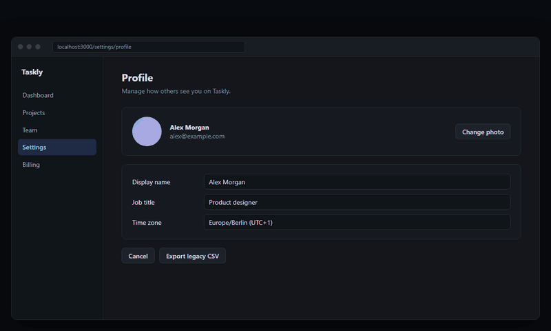
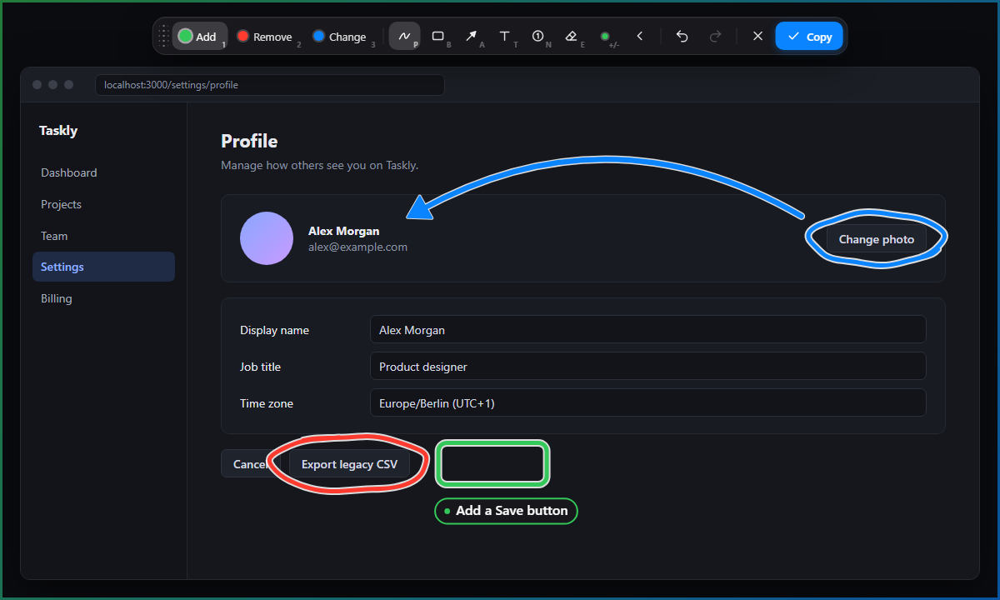
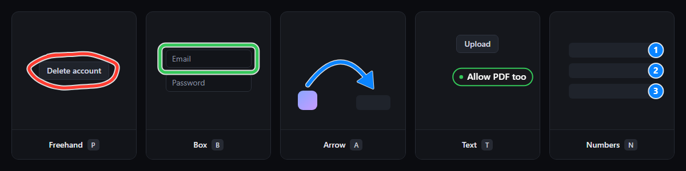
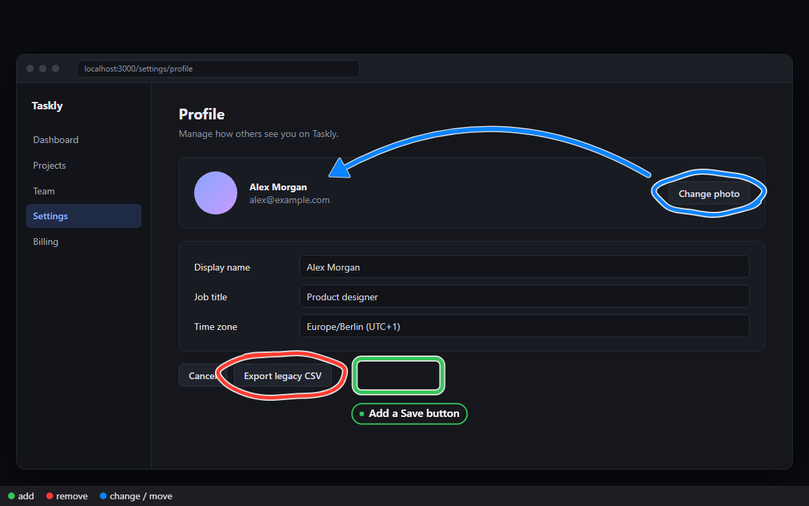
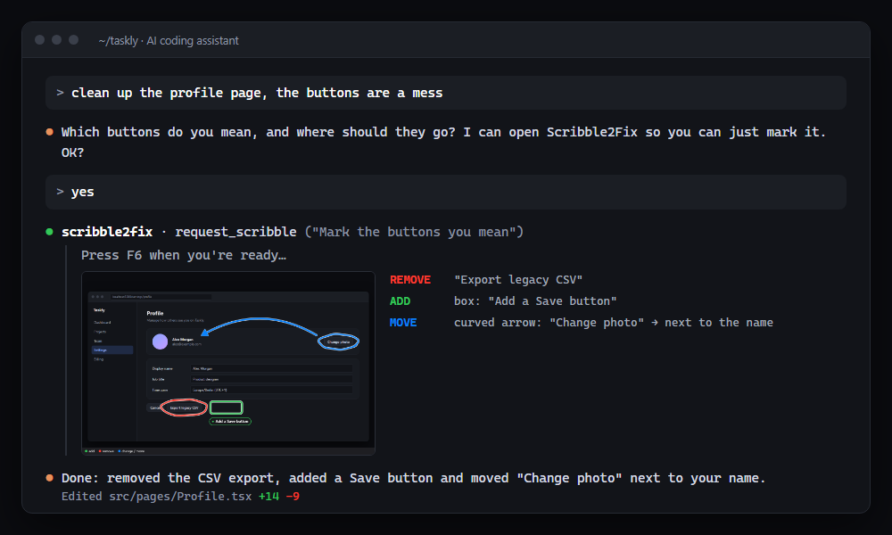
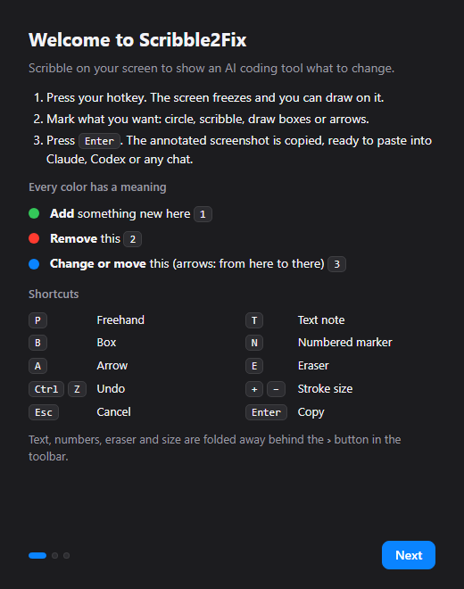

<div align="center">


# Scribble2Fix

### Scribble on your screen to show your AI what to change.

[](https://github.com/cweeperde/scribble2fix/releases/latest)
[](https://github.com/cweeperde/scribble2fix/releases)
[](https://github.com/cweeperde/scribble2fix/stargazers)
[](#license)
[](#built-for-claude-and-codex)
[](#built-for-claude-and-codex)

<br>

[](https://github.com/cweeperde/scribble2fix/releases/latest/download/Scribble2Fix-windows-x64-setup.exe)
[](https://github.com/cweeperde/scribble2fix/releases/latest/download/Scribble2Fix-macos-universal.dmg)
[](https://github.com/cweeperde/scribble2fix/releases/latest/download/Scribble2Fix-linux-x86_64.AppImage)

<sub>Free for personal use · Windows · macOS (Intel & Apple Silicon) · Linux x86_64</sub>

<br><br>



</div>

<br>

Describing UI changes in words is slow: *"the button, no, the other one, under the header…"* With Scribble2Fix you press a hotkey, mark things right on your screen and press **Enter**. Your AI gets an annotated screenshot it understands at a glance.

<table>
<tr>
<td width="50%" valign="top">

**Works on anything you can see**<br>
Websites, desktop apps, design mockups, error dialogs. The screen freezes, so menus and hover states stay put while you draw.

</td>
<td width="50%" valign="top">

**Colors with a meaning**<br>
Green adds, red removes, blue changes or moves. The AI gets the exact positions of your marks, not just a picture.

</td>
</tr>
<tr>
<td width="50%" valign="top">

**Your AI can ask you**<br>
When Claude or Codex isn't sure what you mean, it offers to let you show it, and starts Scribble2Fix if needed.

</td>
<td width="50%" valign="top">

**Fast and private**<br>
Opens in a blink, lives in the tray, and nothing leaves your computer unless you send it.

</td>
</tr>
</table>

## How it works

<table>
<tr>
<td width="33%" align="center" valign="top">

### 1 · Press `F6`

The screen freezes and the toolbar appears.

</td>
<td width="33%" align="center" valign="top">

### 2 · Mark it up

Circle, box, point, number or write a note.

</td>
<td width="33%" align="center" valign="top">

### 3 · Press `Enter`

Copied. Paste it anywhere, or type `/scribble` in your AI tool.

</td>
</tr>
</table>

<div align="center">

</div>

## The toolkit

<div align="center">

</div>

<br>

<table>
<tr>
<td width="40%" valign="top">

**Colors**

| | Key | Meaning |
|:-:|:-:|---|
| 🟢 | `1` | **Add** something here |
| 🔴 | `2` | **Remove** this |
| 🔵 | `3` | **Change or move** this |

</td>
<td width="60%" valign="top">

**Tools**

| Key | Tool |
|:-:|---|
| `P` `B` `A` | Freehand, box, arrow (drag in a curve to bend it) |
| `T` `N` | Text note, numbered marker (*"swap 1 and 2"*) |
| `E` | Eraser, or right-click a mark with any tool |
| `+` `-` | Stroke size, or Ctrl + scroll |

</td>
</tr>
</table>

`Ctrl+Z` undo · `Ctrl+Shift+Z` redo (`Cmd` on macOS) · `Esc` cancel · left-click the tray icon to start without the hotkey. Prefer fewer buttons? Turn on **Simple toolbar** in Settings.

### What your AI gets

The image is cropped to your marks and gets a small color legend, so any AI understands it, even pasted into a plain chat. Connected tools also get the same area without your marks, the name of the app you drew on, and every mark as text: *"REMOVE freehand mark spanning (318, 462) to (540, 532)"*.

<div align="center">

</div>

## Built for Claude and Codex

<div align="center">

</div>

<br>

Scribble2Fix connects with one click, in the welcome screen or later in **Settings → AI tools**:

| Tool | Includes |
|---|---|
| **Claude Code** | the `claude` CLI and the Code tab of the Claude desktop app |
| **Claude Desktop** | chats in the Claude desktop app |
| **Codex** | the `codex` CLI, the Codex desktop app and the IDE extension |

Start a new session after connecting. Then:

- **`/scribble`** sends your latest scribble to the AI. Add instructions if you like: `/scribble make it bigger too`. In Codex type `/prompts:scribble`; in Claude Desktop just ask *"look at my latest scribble"*.
- **The AI can ask for a scribble.** It asks in the chat first. If you agree, a notice pops up (Scribble2Fix starts by itself if it isn't running): press your hotkey, draw, press **Enter**, and the AI continues.
- **Several at once**: make a few scribbles in a row and say *"apply my last 3 scribbles"*.

<details>
<summary><b>Connect manually</b> (if the automatic setup can't find your tool)</summary>

<br>

Use the path where Scribble2Fix is installed:

| Installed with | Path |
|---|---|
| Windows | `%LOCALAPPDATA%\Scribble2Fix\scribble2fix.exe` |
| Windows (.msi) | `C:\Program Files\Scribble2Fix\scribble2fix.exe` |
| macOS | `/Applications/Scribble2Fix.app/Contents/MacOS/scribble2fix` |
| Linux (.deb / .rpm) | `/usr/bin/scribble2fix` |
| Linux (AppImage) | the full path of the `.AppImage` file |

**Claude Code**, Windows (PowerShell):

```powershell
claude mcp add --scope user scribble2fix -- "$env:LOCALAPPDATA\Scribble2Fix\scribble2fix.exe" mcp
New-Item -ItemType Directory -Force "$HOME\.claude\commands" | Out-Null
Invoke-WebRequest https://raw.githubusercontent.com/cweeperde/scribble2fix/main/app/src/scribble.md -OutFile "$HOME\.claude\commands\scribble.md"
```

**Claude Code**, macOS (on Linux use `/usr/bin/scribble2fix`):

```sh
claude mcp add --scope user scribble2fix -- /Applications/Scribble2Fix.app/Contents/MacOS/scribble2fix mcp
mkdir -p ~/.claude/commands
curl -fsSL https://raw.githubusercontent.com/cweeperde/scribble2fix/main/app/src/scribble.md -o ~/.claude/commands/scribble.md
```

**Codex**, Windows (PowerShell):

```powershell
codex mcp add scribble2fix -- "$env:LOCALAPPDATA\Scribble2Fix\scribble2fix.exe" mcp
New-Item -ItemType Directory -Force "$HOME\.codex\prompts" | Out-Null
Invoke-WebRequest https://raw.githubusercontent.com/cweeperde/scribble2fix/main/app/src/scribble.md -OutFile "$HOME\.codex\prompts\scribble.md"
```

**Codex**, macOS (on Linux use `/usr/bin/scribble2fix`):

```sh
codex mcp add scribble2fix -- /Applications/Scribble2Fix.app/Contents/MacOS/scribble2fix mcp
mkdir -p ~/.codex/prompts
curl -fsSL https://raw.githubusercontent.com/cweeperde/scribble2fix/main/app/src/scribble.md -o ~/.codex/prompts/scribble.md
```

**Codex desktop app without the CLI**: add this to `~/.codex/config.toml` (with `\\` for each backslash on Windows):

```toml
[mcp_servers.scribble2fix]
command = "C:\\Users\\<you>\\AppData\\Local\\Scribble2Fix\\scribble2fix.exe"
args = ["mcp"]
```

**Claude Desktop**: open **Settings → Developer → Edit Config**, add this under `mcpServers` and restart Claude:

```json
{
  "mcpServers": {
    "scribble2fix": {
      "command": "C:\\Users\\<you>\\AppData\\Local\\Scribble2Fix\\scribble2fix.exe",
      "args": ["mcp"]
    }
  }
}
```

**Any other MCP client**: run `<path> mcp` as a stdio server. Tools: `get_latest_capture`, `get_recent_captures`, `request_scribble`, `wait_for_scribble`.

To remove it: `claude mcp remove --scope user scribble2fix` or `codex mcp remove scribble2fix`, or simply switch it off in Settings.

</details>

## Install

<table>
<tr>
<td width="33%" valign="top">

### Windows

[](https://github.com/cweeperde/scribble2fix/releases/latest/download/Scribble2Fix-windows-x64-setup.exe)

1. Run the installer.
2. On a SmartScreen warning click **More info → Run anyway** (the app isn't code-signed yet).
3. Scribble2Fix starts in the tray, maybe under the `^` arrow.

<sub>Prefer an MSI? [Download it here](https://github.com/cweeperde/scribble2fix/releases/latest/download/Scribble2Fix-windows-x64.msi).</sub>

</td>
<td width="33%" valign="top">

### macOS

[](https://github.com/cweeperde/scribble2fix/releases/latest/download/Scribble2Fix-macos-universal.dmg)

1. Drag Scribble2Fix into **Applications**.
2. The app isn't notarized yet, so run this once in Terminal:<br>`xattr -dr com.apple.quarantine /Applications/Scribble2Fix.app`
3. Allow **Screen Recording** when asked, then restart the app. It lives in the menu bar.

</td>
<td width="33%" valign="top">

### Linux

[](https://github.com/cweeperde/scribble2fix/releases/latest/download/Scribble2Fix-linux-x86_64.AppImage)

1. `chmod +x Scribble2Fix-*.AppImage` and run it. Updates itself.
2. Or install the [.deb](https://github.com/cweeperde/scribble2fix/releases/latest/download/Scribble2Fix-linux-amd64.deb) or [.rpm](https://github.com/cweeperde/scribble2fix/releases/latest/download/Scribble2Fix-linux-x86_64.rpm) with `apt` / `dnf`.
3. On **Wayland**, bind `scribble2fix --capture` to a shortcut in your desktop settings.

</td>
</tr>
</table>

<table>
<tr>
<td width="62%" valign="middle">

### First start

A short welcome explains the basics, lets you pick your hotkey and connects the AI tools it finds on your computer. After that, Scribble2Fix waits quietly in the tray and updates itself in the background.

**Settings** (right-click the tray icon):

- **Hotkey**, **start at login**, **simple toolbar**
- **Pause in fullscreen apps**, so games keep their F6
- **AI tools**: connect or disconnect each one
- **Captures**: how many to keep, never save images, or copy the file path instead of the image
- **Automatic updates**, and **Show welcome again** under About

</td>
<td width="38%" align="center" valign="middle">



</td>
</tr>
</table>

## Privacy

Everything stays on your computer. Scribbles are saved in `~/.scribble2fix/captures/` (unless you turn saving off) and only leave your machine when you paste them somewhere or a connected AI tool reads them. The only connection Scribble2Fix makes on its own is the update check with GitHub, which you can turn off.

## FAQ

<details>
<summary><b>F6 stopped working in my browser, editor or game</b></summary>

<br>

While Scribble2Fix runs it takes over its hotkey, and many apps use F6 to move focus. Pick another hotkey in Settings. For games and fullscreen videos, turn on **Pause hotkey in fullscreen apps**.
</details>

<details>
<summary><b>macOS: the screenshot only shows my desktop background</b></summary>

<br>

Scribble2Fix is missing the Screen Recording permission, which can happen after an update. Reset it, then allow it again in System Settings → Privacy & Security → Screen Recording and restart the app:

```sh
tccutil reset ScreenCapture dev.scribble2fix.app
```
</details>

<details>
<summary><b>Linux: the hotkey does nothing</b></summary>

<br>

On Wayland, apps usually can't register global hotkeys. Add a keyboard shortcut in your desktop settings that runs `scribble2fix --capture`.
</details>

<details>
<summary><b>/scribble doesn't show up in Claude Code or Codex</b></summary>

<br>

Check that the tool is switched on in **Settings → AI tools**, then start a new session. If it still isn't there, see [Connect manually](#built-for-claude-and-codex).
</details>

<details>
<summary><b>Can I use Scribble2Fix at work?</b></summary>

<br>

Personal and other noncommercial use is free. For use at work or in a company, [ask for a license](https://github.com/cweeperde/scribble2fix/issues/new?template=license_request.yml).
</details>

## Feedback

Found a bug or have an idea? [Open an issue](https://github.com/cweeperde/scribble2fix/issues/new/choose). If Scribble2Fix saves you time, a ⭐ helps others find it.

## License

© 2026 [cweeper](https://github.com/cweeperde). Source available under the [PolyForm Strict License 1.0.0](LICENSE).

- **Free** for personal use, hobby projects, research, schools and other noncommercial organizations.
- **Needs permission**: commercial use (including use at work), changed versions, and redistributing the app or its code.

To ask for permission, [open a license request](https://github.com/cweeperde/scribble2fix/issues/new?template=license_request.yml).
