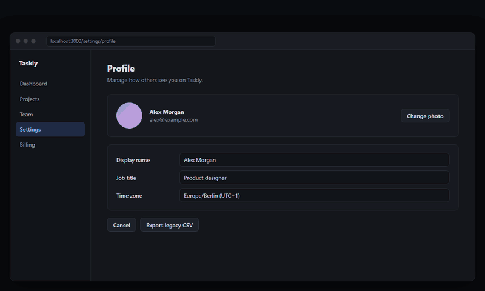
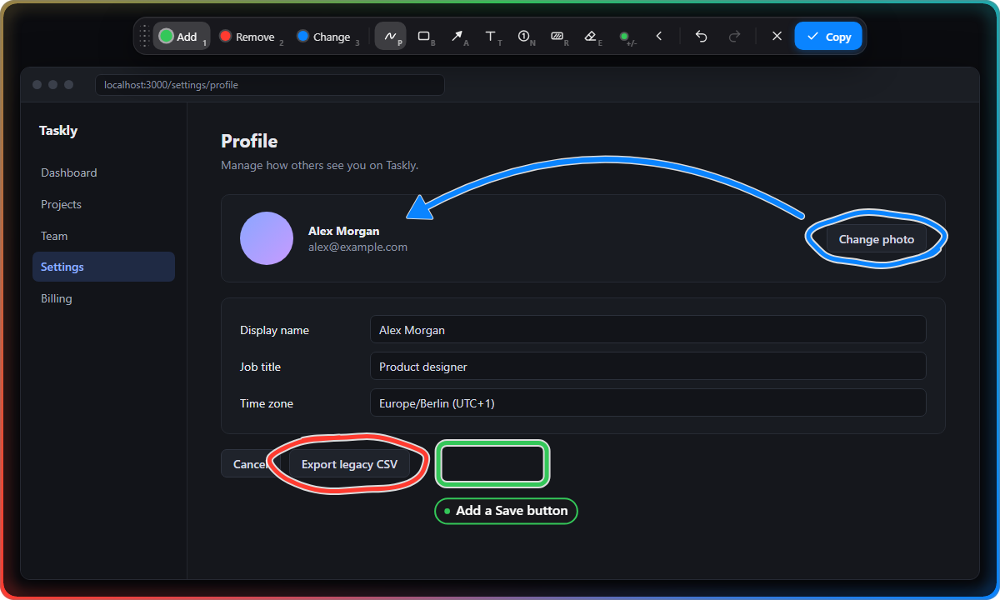
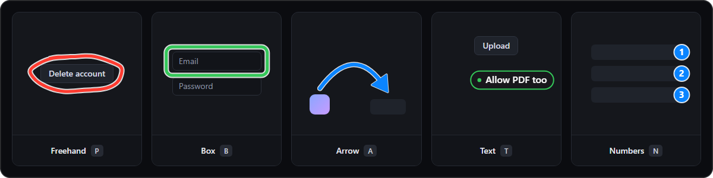
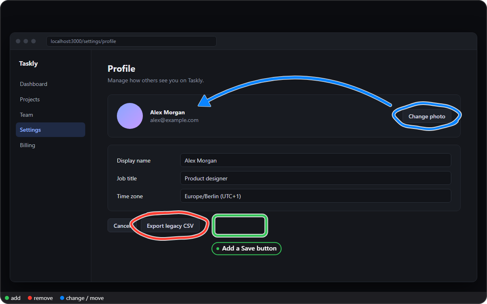
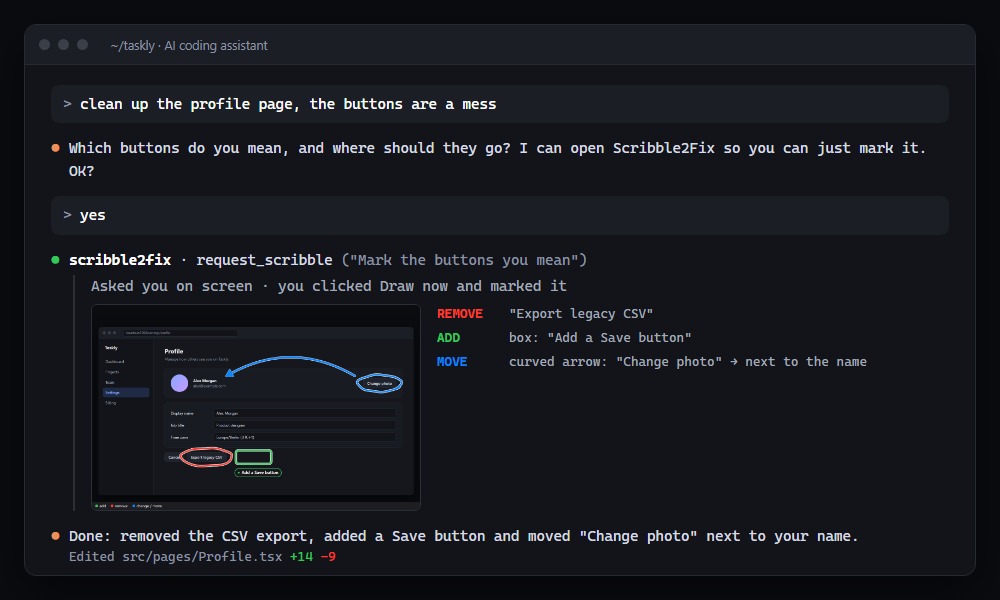
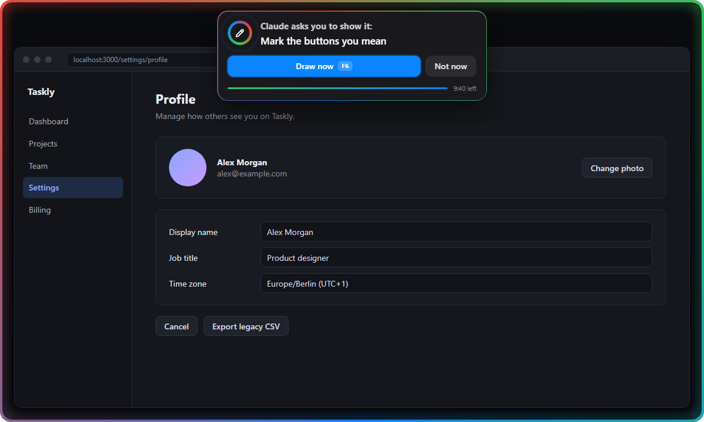
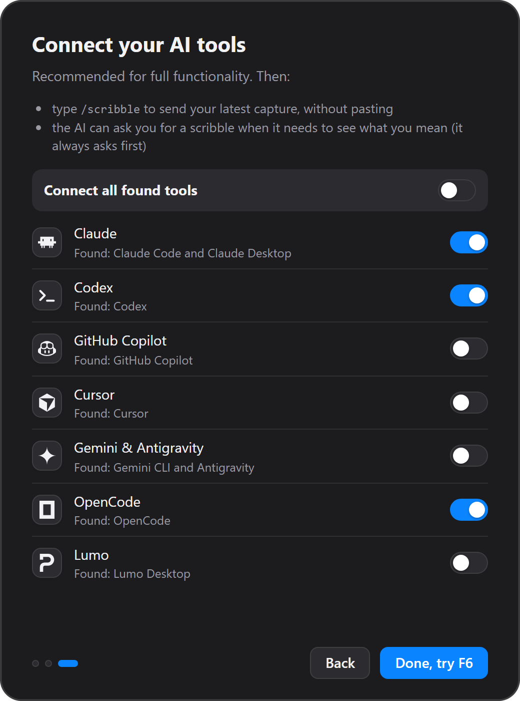

<div align="center">


# Scribble2Fix

### Scribble on your screen to show your AI what to change.

[](https://github.com/cweeperde/scribble2fix/releases/latest)
[](https://hits.sh/github.com/cweeperde/scribble2fix/)
[](https://github.com/cweeperde/scribble2fix/stargazers)
[](#license)

[](#works-with-your-ai-tools)
[](#works-with-your-ai-tools)
[](#works-with-your-ai-tools)
[](#works-with-your-ai-tools)
[](#works-with-your-ai-tools)
[](#works-with-your-ai-tools)
[](#works-with-your-ai-tools)
[](docs/manual-setup.md)

<br>

[](https://github.com/cweeperde/scribble2fix/releases/latest/download/Scribble2Fix-windows-x64-setup.exe)
[](https://github.com/cweeperde/scribble2fix/releases/latest/download/Scribble2Fix-macos-universal.dmg)
[](https://github.com/cweeperde/scribble2fix/releases/latest/download/Scribble2Fix-linux-x86_64.AppImage)

<sub>Free for personal use · Windows · macOS (Intel & Apple Silicon) · Linux x86_64</sub>

<br><br>



</div>

<br>

Describing UI changes in words is slow: *"the button, no, the other one, under the header…"* With Scribble2Fix you press a hotkey, mark things right on your screen and press **Enter**. Your AI gets an annotated screenshot it understands at a glance.

<table>
<tr>
<td width="50%" valign="top">

**Works on anything you can see**<br>
Websites, desktop apps, design mockups, error dialogs. The screen freezes, so menus and hover states stay put while you draw.

</td>
<td width="50%" valign="top">

**Colors with a meaning**<br>
Green adds, red removes, blue changes or moves. The AI gets the exact positions of your marks, not just a picture.

</td>
</tr>
<tr>
<td width="50%" valign="top">

**Your AI can ask you**<br>
When your AI isn't sure what you mean, it offers to let you show it. A card drops in at the top of your screen, and Scribble2Fix starts by itself if needed.

</td>
<td width="50%" valign="top">

**Fast and private**<br>
Opens in a blink, lives in the tray, and nothing leaves your computer unless you send it.

</td>
</tr>
</table>

## How it works

<table>
<tr>
<td width="33%" align="center" valign="top">

### 1 · Press `F6`

The screen freezes and the toolbar appears.

</td>
<td width="33%" align="center" valign="top">

### 2 · Mark it up

Circle, box, point, number or write a note.

</td>
<td width="33%" align="center" valign="top">

### 3 · Press `Enter`

Copied. Paste it anywhere, or type `/scribble` in your AI tool.

</td>
</tr>
</table>

<div align="center">

</div>

## The toolkit

<div align="center">

</div>

<br>

<table>
<tr>
<td width="40%" valign="top">

**Colors**

| | Key | Meaning |
|:-:|:-:|---|
| 🟢 | `1` | **Add** something here |
| 🔴 | `2` | **Remove** this |
| 🔵 | `3` | **Change or move** this |

</td>
<td width="60%" valign="top">

**Tools**

| Key | Tool |
|:-:|---|
| `P` `B` `A` | Freehand, box, arrow (drag in a curve to bend it) |
| `T` `N` | Text note, numbered marker (*"swap 1 and 2"*) |
| `E` | Eraser, or right-click a mark with any tool |
| `+` `-` | Stroke size, or Ctrl + scroll |

</td>
</tr>
</table>

`Ctrl+Z` undo · `Ctrl+Shift+Z` redo (`Cmd` on macOS) · `Esc` cancel · left-click the tray icon to start without the hotkey. Prefer fewer buttons? Turn on **Simple toolbar** in Settings. Several monitors? Pick the one that freezes under **Settings → Monitor** (default: the one under the mouse).

### What your AI gets

The image is cropped to your marks and gets a small color legend, so any AI understands it, even pasted into a plain chat. Connected tools also get the same area without your marks, the name of the app you drew on, and every mark as text: *"REMOVE freehand mark spanning (318, 462) to (540, 532)"*.

<div align="center">

</div>

## Works with your AI tools

<div align="center">

</div>

<br>

Scribble2Fix connects with one click, in the welcome screen or later in **Settings → AI tools**. It sets up everything the tool needs: the MCP server, the `/scribble` command where the tool has commands, and permission to use Scribble2Fix without asking each time.

| Tool | Includes |
|---|---|
| **Claude** | Claude Code (the `claude` CLI and the Code tab of the Claude desktop app) and Claude Desktop chats |
| **Codex** | the `codex` CLI, the Codex desktop app and the IDE extension |
| **GitHub Copilot** | the Copilot CLI and Copilot in VS Code |
| **Cursor** | the Cursor editor |
| **Gemini & Antigravity** | Gemini CLI, the Antigravity IDE and the `agy` CLI |
| **OpenCode** | the `opencode` CLI and the OpenCode desktop app |
| **Lumo** | chats in Proton's Lumo Desktop app (sign in first, restart Lumo after connecting) |
| **Any other MCP client** | Windsurf, Zed, LM Studio, Jan, your own agent, ...: set up by hand or by your AI, see below |

Using something else? Any tool that runs MCP servers works. [Connect by hand](docs/manual-setup.md) has a ready-made prompt: paste it into your AI agent and it sets up Scribble2Fix in the tool of your choice (MCP server, permissions and `/scribble` command).

Start a new session after connecting. Then:

- **`/scribble`** sends your latest scribble to the AI. Add instructions if you like: `/scribble make it bigger too`. In Codex type `/prompts:scribble`; in Claude Desktop and Lumo just ask *"look at my latest scribble"*. If your AI model can't see images, it tells you so and works from the marks as text.
- **The AI can ask for a scribble.** It asks in the chat first. If you agree, a card with its question drops in at the top of your screen, with a soft chime and a glowing frame (Scribble2Fix starts by itself if it isn't running). Click **Draw now** or press your hotkey, draw, press **Enter**, and the AI continues. **Not now** tells the AI you declined. The chime can be turned off in Settings.
- **Several at once**: make a few scribbles in a row and say *"apply my last 3 scribbles"*.

<div align="center">

</div>

**Connect by hand**: if the automatic setup can't find your tool, or you use another MCP client, follow [docs/manual-setup.md](docs/manual-setup.md). It has a copy-and-paste prompt that lets your AI agent do the setup, the settings for any MCP client and step-by-step setups for Claude, Codex, Copilot, Cursor, Gemini, Antigravity, OpenCode, Lumo and more.

## Install

<table>
<tr>
<td width="33%" valign="top">

### Windows

[](https://github.com/cweeperde/scribble2fix/releases/latest/download/Scribble2Fix-windows-x64-setup.exe)

1. Run the installer.
2. On a SmartScreen warning click **More info → Run anyway** (the app isn't code-signed yet).
3. Scribble2Fix starts in the tray, maybe under the `^` arrow.

<sub>Prefer an MSI? [Download it here](https://github.com/cweeperde/scribble2fix/releases/latest/download/Scribble2Fix-windows-x64.msi).</sub>

</td>
<td width="33%" valign="top">

### macOS

[](https://github.com/cweeperde/scribble2fix/releases/latest/download/Scribble2Fix-macos-universal.dmg)

1. Drag Scribble2Fix into **Applications**.
2. The app isn't notarized yet, so run this once in Terminal:<br>`xattr -dr com.apple.quarantine /Applications/Scribble2Fix.app`
3. Allow **Screen Recording** when asked, then restart the app. It lives in the menu bar.

</td>
<td width="33%" valign="top">

### Linux

[](https://github.com/cweeperde/scribble2fix/releases/latest/download/Scribble2Fix-linux-x86_64.AppImage)

1. `chmod +x Scribble2Fix-*.AppImage` and run it. Updates itself.
2. Or install the [.deb](https://github.com/cweeperde/scribble2fix/releases/latest/download/Scribble2Fix-linux-amd64.deb) or [.rpm](https://github.com/cweeperde/scribble2fix/releases/latest/download/Scribble2Fix-linux-x86_64.rpm) with `apt` / `dnf`.
3. On **Wayland**, bind `scribble2fix --capture` to a shortcut in your desktop settings.

</td>
</tr>
</table>

<table>
<tr>
<td width="62%" valign="middle">

### First start

A short welcome explains the basics, lets you pick your hotkey and connects the AI tools it finds on your computer. After that, Scribble2Fix waits quietly in the tray and updates itself in the background.

**Settings** (right-click the tray icon):

- **Hotkey**, **start at login**, **simple toolbar**
- **Pause in fullscreen apps**, so games keep their F6
- **AI tools**: connect or disconnect each one
- **Captures**: how many to keep, never save images, or copy the file path instead of the image
- **Automatic updates**, and **Show welcome again** under About

</td>
<td width="38%" align="center" valign="middle">



</td>
</tr>
</table>

## Privacy

Everything stays on your computer. Scribbles are saved in `~/.scribble2fix/captures/` (unless you turn saving off) and only leave your machine when you paste them somewhere or a connected AI tool reads them. The only connection Scribble2Fix makes on its own is the update check with GitHub, which you can turn off.

## FAQ

<details>
<summary><b>F6 stopped working in my browser, editor or game</b></summary>

<br>

While Scribble2Fix runs it takes over its hotkey, and many apps use F6 to move focus. Pick another hotkey in Settings. For games and fullscreen videos, turn on **Pause hotkey in fullscreen apps**.
</details>

<details>
<summary><b>macOS: the screenshot only shows my desktop background</b></summary>

<br>

Scribble2Fix is missing the Screen Recording permission, which can happen after an update. Reset it, then allow it again in System Settings → Privacy & Security → Screen Recording and restart the app:

```sh
tccutil reset ScreenCapture dev.scribble2fix.app
```
</details>

<details>
<summary><b>Linux: the hotkey does nothing</b></summary>

<br>

On Wayland, apps usually can't register global hotkeys. Add a keyboard shortcut in your desktop settings that runs `scribble2fix --capture`.
</details>

<details>
<summary><b>/scribble doesn't show up in Claude Code or Codex</b></summary>

<br>

Check that the tool is switched on in **Settings → AI tools**, then start a new session. If it still isn't there, see [Connect by hand](docs/manual-setup.md).
</details>

<details>
<summary><b>Can I use Scribble2Fix at work?</b></summary>

<br>

Personal and other noncommercial use is free. For use at work or in a company, [ask for a license](https://github.com/cweeperde/scribble2fix/issues/new?template=license_request.yml).
</details>

## Feedback

Found a bug or have an idea? [Open an issue](https://github.com/cweeperde/scribble2fix/issues/new/choose). If Scribble2Fix saves you time, a ⭐ helps others find it.

## License

© 2026 [cweeper](https://github.com/cweeperde). Source available under the [PolyForm Strict License 1.0.0](LICENSE).

- **Free** for personal use, hobby projects, research, schools and other noncommercial organizations.
- **Needs permission**: commercial use (including use at work), changed versions, and redistributing the app or its code.

To ask for permission, [open a license request](https://github.com/cweeperde/scribble2fix/issues/new?template=license_request.yml).

### Trademarks

Scribble2Fix is an independent project. It isn't affiliated with, endorsed by or sponsored by Anthropic, OpenAI, GitHub, Microsoft, Anysphere (Cursor), Google, OpenCode, Proton or any other company whose tools it works with. Claude, Codex, GitHub Copilot, Cursor, Gemini, Antigravity, OpenCode, Lumo and Proton are trademarks of their respective owners, as are the names of the other tools mentioned here. Their names and logos appear in the app and this README only to show which tools Scribble2Fix connects to. The logos come from [Simple Icons](https://simpleicons.org) (CC0). Codex is shown with a plain terminal symbol, not an OpenAI logo.
